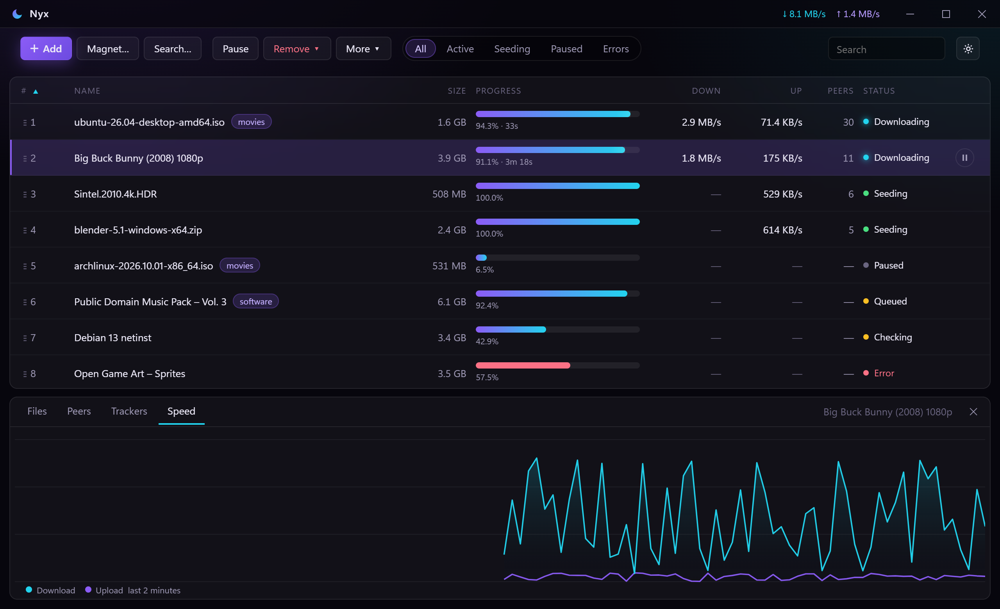
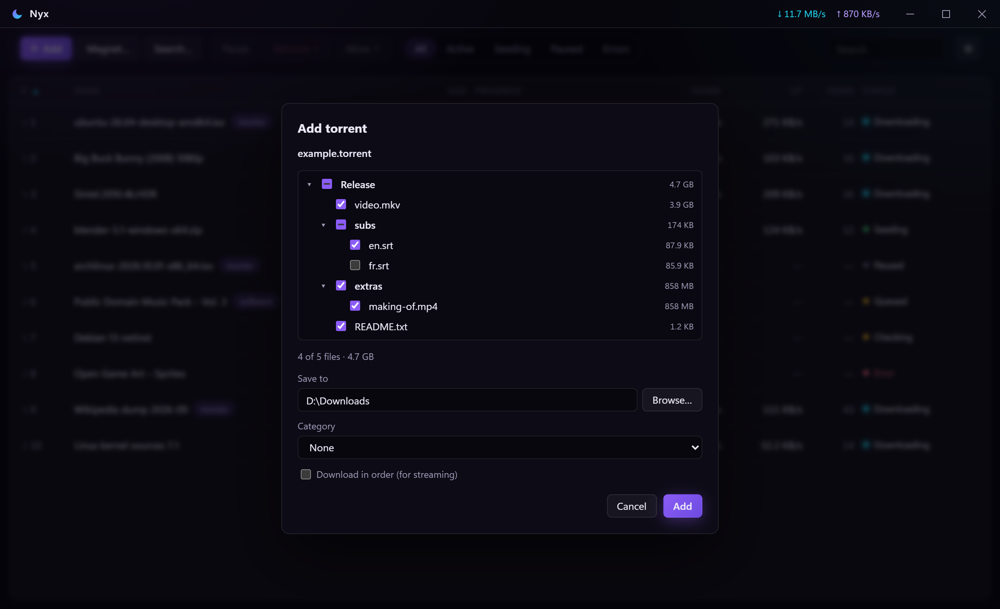
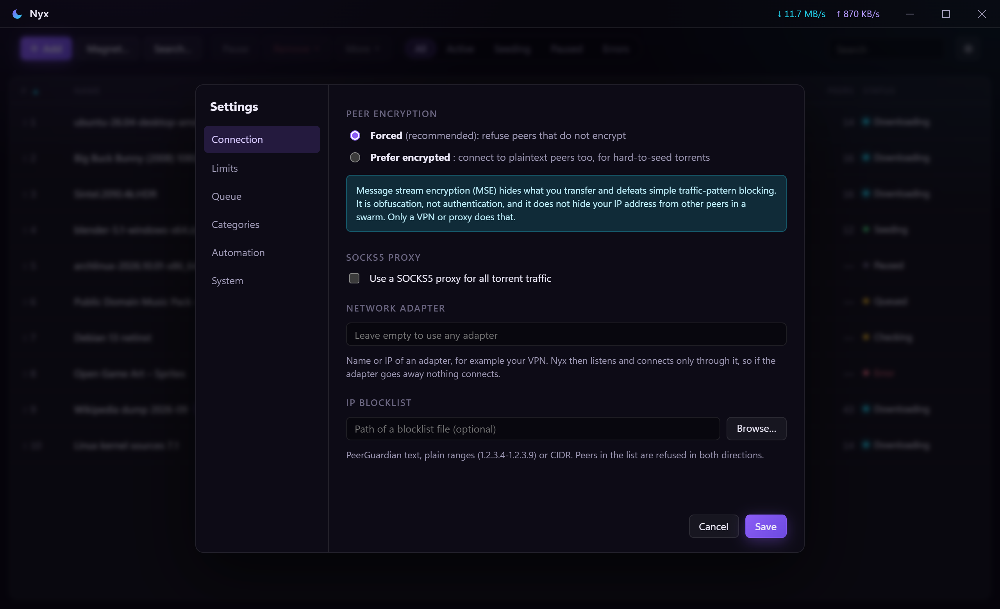
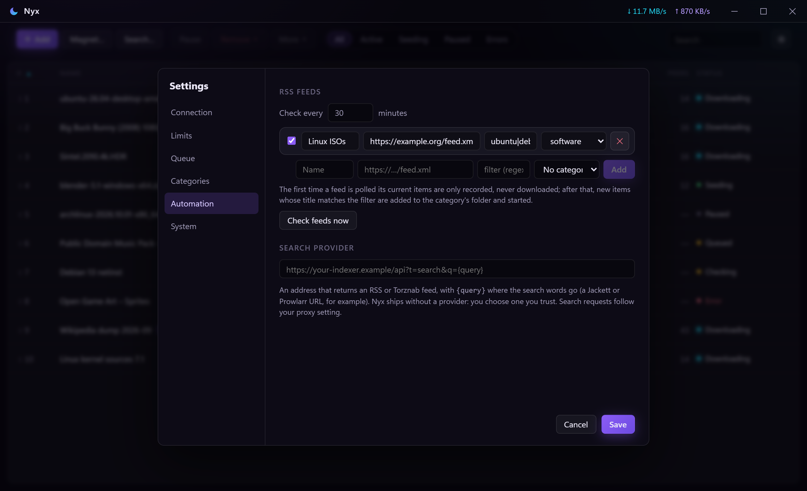
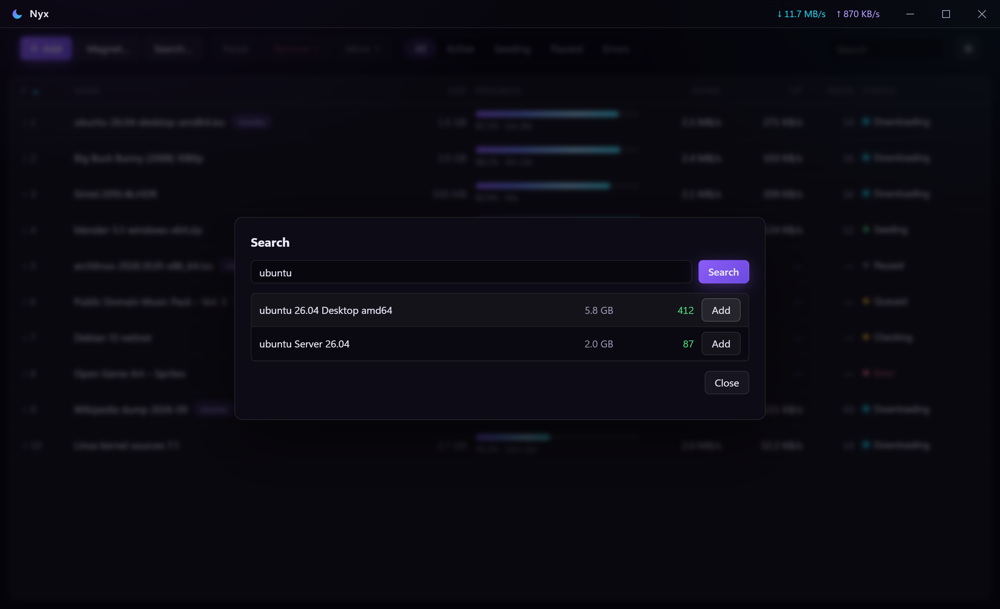

<h1 align="center">Nyx</h1>

<p align="center">
  A fast, private torrent client for Windows.<br>
  One portable <code>.exe</code>. Forced peer encryption, SOCKS5 proxy with a kill switch, dark UI. No installer, no telemetry.
</p>

<p align="center">
  <a href="https://github.com/walkingcorpses/nyx-releases/releases/latest"><b>Download the latest version</b></a>
</p>

<p align="center">
  
</p>

---

## Download

1. Open the **[latest release](https://github.com/walkingcorpses/nyx-releases/releases/latest)** and download **`Nyx-<version>-windows-x64.exe`**.
2. Put it anywhere you like and double-click it. There is nothing to install.

**Needs:** Windows 11 (Windows 10 works too if the Microsoft Edge *WebView2 Runtime* is installed; Windows 11 has it built in). 64-bit only.

### Check the download (optional but easy)

Every release lists a SHA-256 next to the file, and ships a `.sha256` file. In PowerShell:

```powershell
Get-FileHash .\Nyx-1.0.0-windows-x64.exe -Algorithm SHA256
```

The hash must match the one on the release page.

### "Windows protected your PC"

Nyx is not code-signed (a certificate costs money and this is a hobby project), so Windows SmartScreen may warn the first time. Click **More info**, then **Run anyway**. The checksum above is how you know you got the file that was published.

## What you get

| | |
|---|---|
| **Adding** | `.torrent` files (button, drag and drop, "open with") and magnet links (paste anywhere, click a magnet link). A file tree lets you pick what to download before it starts, plus save folder, category and "download in order". |
| **Managing** | Pause, resume, remove (optionally with files), recheck, open folder, copy magnet. Drag the grip in the **#** column to reorder the queue. |
| **Queue & limits** | Max active downloads and seeds, global and per-torrent speed limits, and a weekly schedule that swaps in different limits by day and time. |
| **Categories** | Each category has its own folder; the add dialog switches to it automatically. |
| **Everywhere** | Tray icon, notifications when a download finishes, single instance (clicking a magnet while Nyx is hidden in the tray opens it in the running app). |

<p align="center">
  
</p>

## Privacy and security

Nyx is built so that "private" is the default, and where it can only go so far, it says so.

- **Peer encryption is forced by default.** Peers that do not encrypt are refused. A setting lets you accept plaintext peers for hard-to-seed torrents.
- **SOCKS5 proxy for everything.** Peers, trackers and hostname lookups go through your proxy. While a proxy is on, Nyx also **turns off DHT, local peer discovery, UPnP and NAT-PMP, and refuses direct inbound connections**, so nothing can go around it. If the proxy is down, torrents do **not** fall back to a direct connection.
- **Kill switch.** With a proxy set, Nyx checks it every few seconds. If it cannot be reached, every torrent is paused and a banner tells you; they resume by themselves when it is back.
- **Bind to one network adapter** (for example your VPN). Nyx then listens and connects only through that adapter, so if the VPN drops, nothing connects.
- **IP blocklist.** Load a PeerGuardian, plain-range or CIDR list and those addresses are refused in both directions.
- **No telemetry.** The only network traffic is torrent traffic. The optional extras below (update check, RSS, search) are off or empty until you set them, and they also go through your proxy.
- **Hardened app shell.** No remote content in the window, a strict content security policy, and the interface can only call the handful of commands it needs. Torrent files and magnet links are treated as untrusted input; a torrent cannot write outside its save folder.

<p align="center">
  
</p>

**What encryption does and does not do.** Message stream encryption hides *what* you transfer and defeats simple traffic-pattern blocking. It is obfuscation, not authentication, and it **does not hide your IP address from the other peers in a swarm**. Only a VPN or proxy does that, which is why Nyx makes them easy to use properly.

**What was tested.** Nyx is tested against the real protocol, not just mocked: sessions seeding to each other on loopback, a plaintext-only peer that forced mode must refuse, a SOCKS5 test server that proves peer connections, UDP tracker announces and inbound connections behave as promised (and that nothing leaks when the proxy is down), plus a real download through the proxy from a public swarm. One thing is *not* covered by an automated test: the adapter binding was only tested against an adapter that does not exist, not a live VPN.

## Automation (all optional)

<p align="center">
  
</p>

- **RSS auto-download.** Add feeds with a title filter (a case-insensitive regular expression) and an optional category. The first time a feed is polled Nyx only *records* what is already there, so adding a feed never floods your downloads; after that, new matching items are added and started in the category's folder. Items are remembered across restarts.
- **Built-in search.** Nyx does not ship with a search provider or any feeds. You point it at an RSS/Torznab address that contains `{query}` (for example your own Jackett or Prowlarr), and the **Search…** button searches it. Pick a result and it opens in the normal add dialog.
- **Updates.** Off by default. Switch on *Check for a newer Nyx when it starts* (or press *Check now*) and Nyx asks this repository for the latest release. An update is only installed after its **SHA-256 matches the one GitHub reports**, from this repository only; the old exe is kept as `nyx.exe.old` until the next start. Nothing is installed without you pressing *Update now*.

<p align="center">
  
</p>

## Where is my data?

In `%APPDATA%\Nyx` (settings, session state, resume data, RSS history). Want it portable? Create an empty file named **`nyx.portable`** next to `Nyx-….exe` and Nyx keeps everything in that folder instead. Delete the folder to remove every trace.

To make Nyx open `.torrent` files and magnet links: **Settings → System → Make Nyx the default** (your account only, no admin rights needed).

## FAQ

**Why does the DHT stop when I use a proxy?** DHT is UDP traffic to arbitrary nodes; letting it run would be a way around the proxy. With a proxy set, Nyx finds peers through trackers (which do go through the proxy).

**Does the kill switch protect me if I use a VPN instead of a proxy?** The kill switch watches the SOCKS5 proxy. For a VPN, use *Network adapter* binding: Nyx connects only through that adapter.

**Is it safe to automate downloads?** Nyx never runs anything it downloads and only ever adds torrents. You are responsible for what your feeds and search provider point at.

**Where is the source code?** In a private repository for now; this repository only holds the downloads and this page.

## Please use it lawfully

Nyx is a neutral BitTorrent client, like any other. Only download and share content you have the right to. It ships with no search provider, no feeds and no trackers of its own.

## What's new

### 1.0.0

First public release. Everything above: forced encryption, SOCKS5 proxy with leak protection and kill switch, adapter binding, IP blocklist, queue with drag-to-reorder, categories, schedule, RSS auto-download, search, opt-in checksummed self-update, tray, single instance and file associations.

## Credits

Built with [libtorrent-rasterbar](https://libtorrent.org/), [Tauri](https://tauri.app/), [Rust](https://www.rust-lang.org/) and [Svelte](https://svelte.dev/).

MIT licensed.
